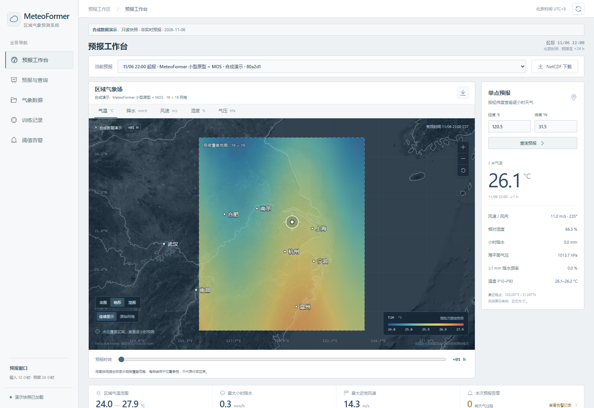
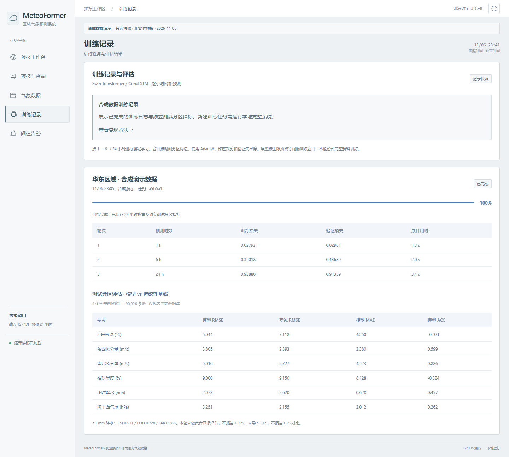

<p align="center"></p>

<h1 align="center">MeteoFormer</h1>
<p align="center">区域气象预测工作台 · 从网格数据到可交互的 24 小时预报</p>
<p align="center"><a href="https://guhang2011.github.io/meteoformer-weather-system/"><strong>打开在线 Demo ↗</strong></a> · <a href="#本地运行完整系统">本地运行</a> · <a href="guides/设计对照与改造记录.md">设计与实现范围</a></p>

[](https://guhang2011.github.io/meteoformer-weather-system/)

基于 **Vue 3 / TypeScript / FastAPI / PyTorch** 的气象预测研究原型。以地图为主要工作区域，将要素、时效、经纬度查询与模型实验组织在同一个工作台中。

> **在线版使用合成数据和已完成实验的只读快照，不提供实时天气服务。** 本地版支持实际数据导入、模型训练和推理。演示结果用于验证软件流程，不能证明真实天气预报精度，也不作为官方预警。

## 先体验这几步

1. [打开 Demo](https://guhang2011.github.io/meteoformer-weather-system/)，切换气温、降水、风速、湿度和气压。
2. 拖动底部时间轴，查看未来 1–24 小时的变化；同一批次色标保持固定。
3. 点击预报覆盖区域，或输入经纬度，查看最近格点的逐小时预报。
4. 切换地形／简图、原始网格／连续显示，下载当前时效的 PNG 或完整 NetCDF。
5. 进入「训练记录」，查看实际完成的 3 轮训练日志及测试分区指标。

## 在线演示与完整系统

地图已加入 **NASA Blue Marble 静态地形、Natural Earth 河流与湖泊**，可切换地形／简图；素材随项目加载，无需地图密钥。预报数据仍为合成快照。来源、授权和处理方法见 [地理素材说明](guides/真实地理素材.md)。

| 能力 | 在线 Demo | 本地完整系统 |
| --- | --- | --- |
| 地图、5 类要素、24 小时时效 | ✓ | ✓ |
| 缩放、原始网格、经纬度查询与曲线 | ✓ | ✓ |
| PNG / NetCDF 下载 | 已导出快照 | 按实际预报导出 |
| 数据集、训练日志、模型与基线指标 | 查看已完成实验 | 实际导入、训练和评估 |
| 生成预报、集合推理、修改阈值 | 只读 | 管理员操作 |
| ERA5 / GFS 自动采集、卫星雷达接入 | 未实现 | 未实现；可导入符合约定的 NetCDF |

在线快照来自一次真实执行的本地实验：**480 小时合成数据、16 × 16 网格、90,926 个模型参数、1 → 6 → 24 小时课程训练、4 成员集合预报**。时间和数值保留原始实验记录，不随访问日期伪造更新。

<details>
<summary>查看训练记录与移动端界面</summary>




</details>

## 本地运行完整系统

环境：Python 3.12、Node.js 20+。以下命令从项目根目录执行。

```bash
git clone https://github.com/GuHang2011/meteoformer-weather-system.git
cd meteoformer-weather-system
python -m venv .venv
```

Windows：

```powershell
.\.venv\Scripts\python.exe -m pip install -r backend\requirements-model.txt
.\start.ps1
```

Linux / macOS：

```bash
.venv/bin/pip install -r backend/requirements-model.txt
npm --prefix frontend ci
npm --prefix frontend run build
.venv/bin/python -m uvicorn meteo.app:app --app-dir backend --host 127.0.0.1 --port 8016 --workers 1
```

访问 **http://127.0.0.1:8016**。首次启动生成的管理员密码位于 `backend/data/initial-admin-password.txt`；也可通过环境变量 `METEO_ADMIN_PASSWORD` 设置。登录后创建合成数据或导入 NetCDF，再启动训练、生成预报。**线上快照不会自动导入本地数据库**；可在 Demo「气象数据」页下载样例文件。

只需要持续性基线时可安装 `backend/requirements.txt`。详细变量单位、数据校验、命令行和环境配置见 [运行说明](guides/运行说明.md)。

## 构建演示版

```bash
cd frontend
npm ci
npm run typecheck
npm run build:demo
npx vite preview --mode demo --host 127.0.0.1 --port 4176
```

打开 `http://127.0.0.1:4176/meteoformer-weather-system/`。`demo-public/demo` 包含经过检查的合成快照和下载文件；构建产物为 `demo-dist`。GitHub Pages 从主分支 `docs/` 发布，更新演示时将新构建产物同步至该目录并保留 `.nojekyll`。

从本地服务重新导出合成快照：

```bash
python scripts/export-demo.py --forecast-id YOUR_SYNTHETIC_FORECAST_ID
```

导出器只接受合成数据，读取公开接口，不复制账号、数据库、密码或模型权重。

## 工程结构

```text
frontend/          Vue 界面、地图、在线演示适配与公开快照
backend/meteo/     FastAPI、数据校验、Swin + ConvLSTM、MOS、集合预测
backend/tests/     权限、数据、训练与推理集成测试
scripts/           浏览器验证、快照导出、底图转换
guides/            设计对照、界面参考、验证与运行说明
docs/              GitHub Pages 静态发布产物
```

网格保存为 Zarr，索引使用 SQLite。按时间 70% / 15% / 15% 划分数据，标准化只拟合训练分区，MOS 只拟合验证分区。当前为单进程研究原型，未完成业务精度、概率校准或生产容量验证。

## 验证与参考

```bash
cd backend
python -m pytest tests -q
cd ..
node scripts/test-demo.cjs
```

浏览器验证需要先启动上述演示预览，并在 `frontend` 运行 `npx playwright install chromium`。本地已通过 6 项后端集成测试（含实际模型训练与集合推理）、前端类型检查、两种模式构建及 320–1600 px 演示交互检查，详见 [验证记录](guides/在线演示验证.md)。

界面信息架构参考 [Windy](https://www.windy.com/)、[Ventusky](https://www.ventusky.com/)、[ECMWF Charts](https://charts.ecmwf.int/) 和 [Zoom Earth](https://zoom.earth/)；未复制这些网站的代码与地图资源。海岸线来自公共领域 [Natural Earth](https://www.naturalearthdata.com/about/terms-of-use/)，仅作为位置参照。[界面参考说明](guides/界面参考与改造.md)。
